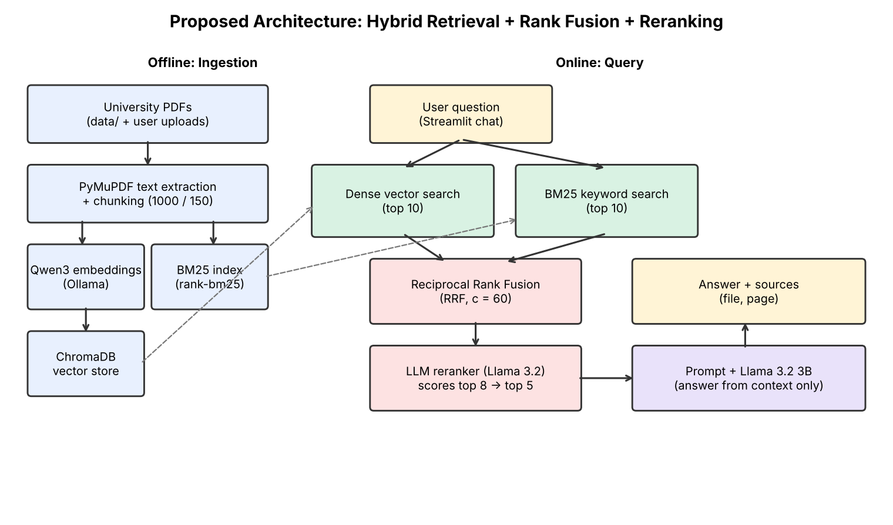
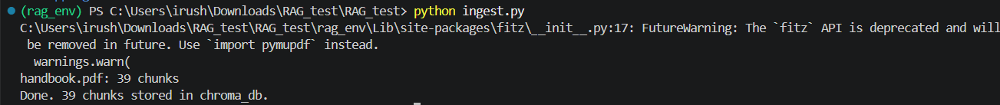
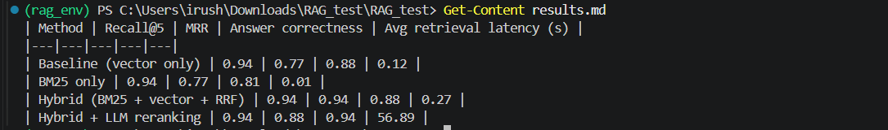
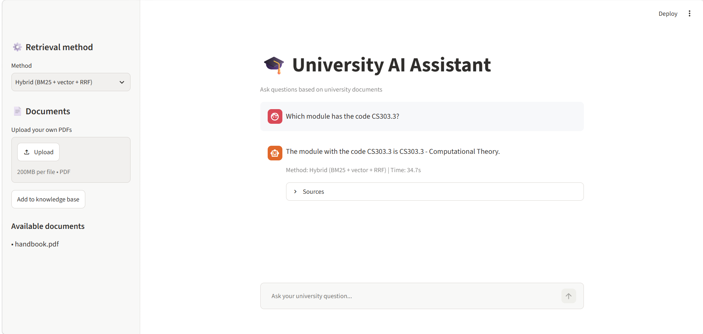
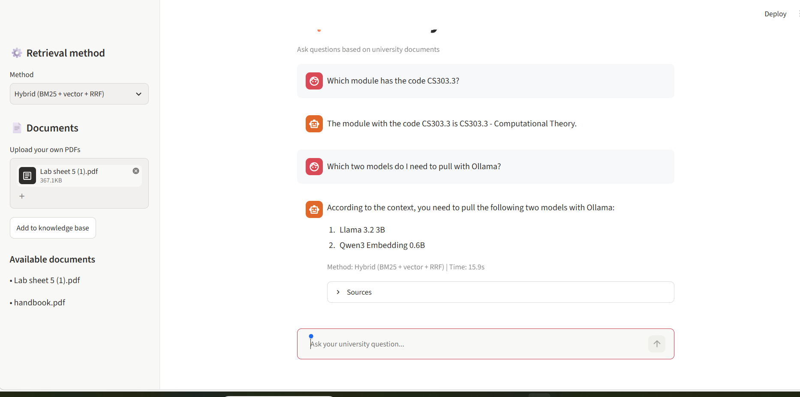

# Lab Sheet 5 Summary - RAG Architecture

**Module:** PUSL 3205 - Large Language Models and Generative AI

## 1. What Lab Sheet 5 is about

Lab Sheet 5 teaches how to build a **RAG (Retrieval-Augmented Generation)** application.
A normal LLM only knows what it was trained on. RAG lets the LLM answer questions from
**our own documents** (here, university PDFs) by first retrieving the relevant text and then
giving it to the LLM as context.

The sheet has four parts:

1. Setting up the Python environment
2. Installing the LLM and embedding model
3. Building the ingestion and RAG pipeline
4. Task and group activity

## 2. Part 1 - Python environment

Steps from the lab sheet:

1. Create a project folder and open it in the terminal.
2. Create a virtual environment: `py -3.12 -m venv rag_env`
3. Activate it: `.\rag_env\Scripts\Activate.ps1`
4. Install libraries: `langchain`, `langchain-community`, `langchain-ollama`, `langchain-chroma`,
   `chromadb`, `streamlit`, `pymupdf`, `python-docx`, `sentence-transformers`, `python-dotenv`
5. Check ChromaDB: `python -c "import chromadb; print('ChromaDB installed successfully')"`
6. Save dependencies: `pip freeze > requirements.txt`

**LangChain** is an open-source framework that connects LLMs with data sources, embedding
models, vector databases, retrievers and other tools.

**The RAG workflow with LangChain:**

User query -> Document Loader -> Text Splitter (chunks) -> Embeddings -> Vector Store ->
Retrieve similar chunks -> Prompt Template -> LLM -> Response

## 3. Part 2 - LLM and embedding model (Ollama)

| Component | Tool used |
|---|---|
| LLM | Llama 3.2 3B via Ollama (`ollama pull llama3.2:3b`) |
| Embedding model | Qwen3 Embedding 0.6B (`ollama pull qwen3-embedding:0.6b`) |
| Vector database | ChromaDB |
| Python environment | `rag_env` |

`ollama list` (or http://localhost:11434) is used to check that Ollama is running.

## 4. Part 3 - Ingestion, pipeline and chat app

- **`ingest.py`** - reads the PDFs, splits them into chunks, creates embeddings and stores them in ChromaDB.
- **`rag_pipeline.py`** - takes a question, retrieves the most similar chunks from ChromaDB,
  puts them in a prompt and asks Llama 3.2 to answer from that context.
- **Streamlit chat window (`app.py`)** - a browser-based "University AI Assistant" where the user
  types a question and gets an answer from the university documents.

## 5. The task

> Modify the above app so that it reads more PDFs and gives the output. Whenever it is required,
> users can upload their own PDFs and get the answers.

## 6. What I did for the task

**`rag_pipeline.py`**
- Reads PDFs page by page with PyMuPDF and keeps the file name and page number of every chunk.
- Splits text into 1000-character chunks with 150 characters of overlap.
- Stores each PDF's chunks in ChromaDB with IDs based on the file content, so the same PDF is never stored twice.
- Answers using only the retrieved context and returns the sources (file and page).

**`ingest.py`** - loads **every PDF** in the `data/` folder into the database in one run.

**`app.py`** - Streamlit app with:
- a sidebar where users **upload their own PDFs** and click "Add to knowledge base"
- a list of all available documents
- a chat window with chat history
- a "Sources" section under each answer

## 7. Group activity: Enhancing the RAG system (Group 1)

The group activity asks for an advanced RAG architecture that improves at least one limitation of
the basic system. I chose **Group 1 - Hybrid Retrieval and Reranking**.

**Problem with the basic RAG:** vector search understands meaning but can rank the correct page low
when the question contains exact terms such as module codes (for example CS303.3).

**What I built (`hybrid_rag.py`):**
1. **BM25 keyword search** - finds chunks containing the exact words in the question.
2. **Vector search** - finds chunks with similar meaning.
3. **Reciprocal Rank Fusion (RRF)** - merges both ranked lists: score = sum of 1 / (60 + rank).
4. **LLM reranking** - Llama 3.2 scores the top 8 chunks from 0 to 10 and the best 5 are used.

The sidebar of the app lets the user switch between: Baseline (vector only), BM25 only,
Hybrid (BM25 + vector + RRF) and Hybrid + LLM reranking.



## 8. Evaluation

- **Dataset:** `eval_dataset.json` - 16 questions about the NSBM Computing Awards Handbook, each with a
  reference answer, supporting page numbers and keywords.
- **Script:** `evaluate.py --answers`
- **Metrics:** Recall@5, MRR, answer correctness, retrieval latency.

| Method | Recall@5 | MRR | Answer correctness | Avg retrieval latency (s) |
|---|---|---|---|---|
| Baseline (vector only) | 0.94 | 0.77 | 0.88 | 0.12 |
| BM25 only | 0.94 | 0.77 | 0.81 | 0.01 |
| Hybrid (BM25 + vector + RRF) | 0.94 | 0.94 | 0.88 | 0.27 |
| Hybrid + LLM reranking | 0.94 | 0.88 | 0.94 | 56.89 |

## 9. Findings

- Hybrid retrieval raised **MRR from 0.77 to 0.94** with almost no extra delay (0.27 s), so the correct page is ranked higher.
- BM25 alone is the fastest (0.01 s) but gave the lowest answer correctness (0.81).
- LLM reranking gave the best answer correctness (0.94) but took about **57 seconds per question**, which is too slow for a chat assistant.
- **Best overall trade-off:** Hybrid (BM25 + vector + RRF).

**Limitations:** only 16 questions, one document, a simple keyword-based correctness check, and a small 3B model used as reranker.

## 10. Screenshots

**Ingesting the PDFs**



**Evaluation results**



**App answering with the Hybrid method**



**Uploading and asking about my own PDF**



## 11. How to run

```
python -m venv rag_env
.\rag_env\Scripts\Activate.ps1
python -m pip install -r requirements.txt
ollama pull llama3.2:3b
ollama pull qwen3-embedding:0.6b
python ingest.py
python -m streamlit run app.py
python evaluate.py --answers
```

## 12. Conclusion

Lab Sheet 5 showed how a complete RAG system works: loading documents, chunking, embedding,
storing in a vector database, retrieving and generating answers with a local LLM. The app was
extended to read many PDFs and accept user uploads, and the group activity improved retrieval with
hybrid search and reranking, with measured results.
