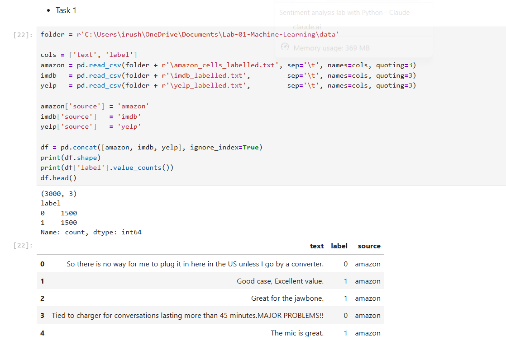
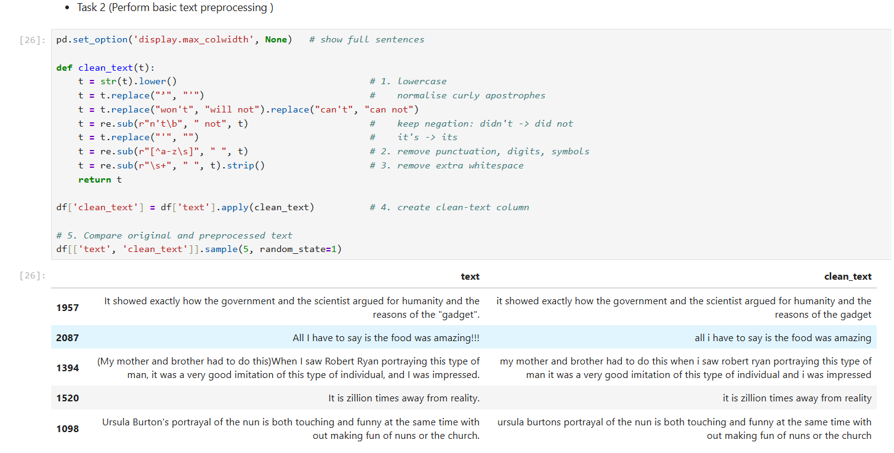
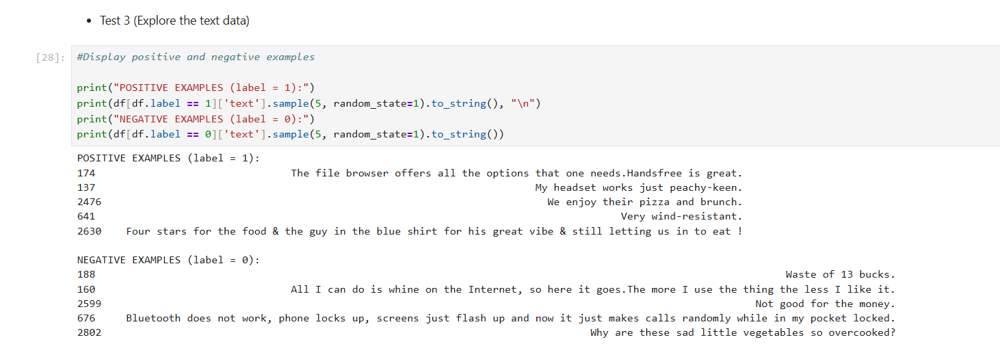
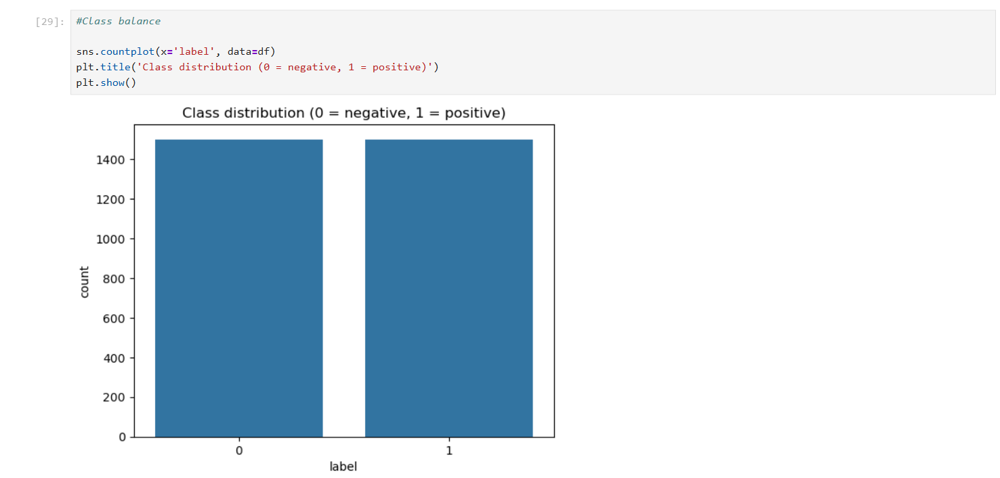
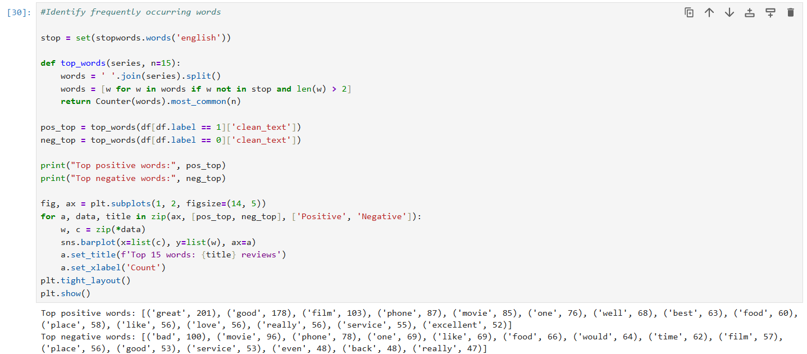

# Lab 01: Sentiment Analysis Using Traditional Machine Learning

**Module:** PUSL3205 Large Language Models and Generative AI

## Contents
- [Laboratory Session](#laboratory-session)
- [Objective](#objective)
- [Folder Structure](#folder-structure)
- [Tasks and Implementation](#tasks-and-implementation)
- [Results and Evidence](#results-and-evidence)
- [Observations](#observations)
- [Learning Outcomes](#learning-outcomes)
- [How to Run](#how-to-run)
- [Dataset Citation](#dataset-citation)

## Laboratory Session
**Lab 1:** Sentiment Analysis Using Traditional Machine Learning

## Objective
The purpose of this lab was to practise basic NLP tasks: cleaning raw text, exploring it, converting it to numeric features with Bag-of-Words (BoW), and training and evaluating classical machine learning models (Logistic Regression and Linear SVM) to classify sentences as positive or negative.

**Dataset:** Sentiment Labelled Sentences (UCI Machine Learning Repository). It contains 3000 sentences from Amazon, IMDb and Yelp reviews, with 1500 positive (label 1) and 1500 negative (label 0).

**Tools:** Python, Pandas, NumPy, NLTK, Scikit-learn, Matplotlib, Seaborn (Jupyter Notebook via Anaconda).

## Folder Structure
```
Lab-01-Machine-Learning/
├── README.md
├── data/
│   ├── amazon_cells_labelled.txt
│   ├── imdb_labelled.txt
│   └── yelp_labelled.txt
├── notebook/
│   └── lab01.ipynb
└── screenshots/
    └── (evidence images 1 to 8.1 (total 24))
```

## Tasks and Implementation

The full code and outputs are in [`notebook/lab01.ipynb`](notebook/lab01.ipynb).

### Task 1: Download and load the dataset
The three files are tab-separated with no header (`sentence \t score`). I loaded each one with `pd.read_csv(..., sep='\t', names=['text','label'], quoting=3)`, added a `source` column, and combined them into one DataFrame of shape `(3000, 3)` with 1500 sentences per class.



### Task 2: Text preprocessing
I wrote a `clean_text()` function that:
1. converts text to lowercase,
2. expands contractions so negation is kept (`didn't` becomes `did not`, `won't` becomes `will not`),
3. removes punctuation, digits and symbols with a regular expression,
4. removes extra whitespace.

The output is stored in a new `clean_text` column.

```python
def clean_text(t):
    t = str(t).lower()                                   # lowercase
    t = t.replace("’", "'")                              # normalise curly apostrophes
    t = t.replace("won't", "will not").replace("can't", "can not")
    t = re.sub(r"n't\b", " not", t)                      # keep negation
    t = t.replace("'", "")
    t = re.sub(r"[^a-z\s]", " ", t)                      # remove punctuation, digits, symbols
    t = re.sub(r"\s+", " ", t).strip()                   # remove extra whitespace
    return t
```

Comparison of original and preprocessed text:



Demo on one sentence (`Wow...   I didn't like it!!  It's NOT 100% GREAT :)` becomes `wow i did not like it its not great`):


### Task 3: Explore the text data
- Displayed random positive and negative examples.
- Plotted the class distribution.
- Counted the 15 most frequent words per class (stopwords removed for these charts only).
- Compared words common to both classes with words found in only one class.
- Compared sentence length between classes.




.png)


The written comparison of positive and negative reviews, as it appears in the notebook:


### Task 4: Split the dataset
I used `train_test_split(test_size=0.2, random_state=42, stratify=y)`. This gave 2400 training sentences and 600 test sentences, with 1200 of each class in the training set. `stratify=y` keeps the class balance equal in both parts.

### Task 5: Bag-of-Words representation
I used `CountVectorizer(max_features=5000)`. The vectorizer was **fitted on the training data only** and then applied to the test data, to avoid data leakage. Stopwords were **not** removed here, so negation words such as "not" and "no" stay in the vocabulary. The training matrix has shape `(2400, 4504)` and the test matrix `(600, 4504)`.


### Task 6: Train the models
I trained two classifiers on the BoW features:
- `LogisticRegression(max_iter=1000)`
- `LinearSVC()`

### Task 7: Evaluate the models
I evaluated both models on the unseen test set using accuracy, precision, recall, F1-score and a confusion matrix.


### Task 8: Test with new sentences
I wrote a `predict_sentiment()` function that cleans a new sentence, converts it with the trained vectorizer and predicts the label with each model. I used 7 sentences, including a mixed one, a neutral one and two with negation.

## Results and Evidence

**Model comparison (600 test sentences):**

| Model | Accuracy | Precision | Recall | F1-score |
|-------|----------|-----------|--------|----------|
| Logistic Regression | 0.8217 | 0.7988 | 0.8600 | 0.8283 |
| Linear SVM | 0.8017 | 0.7751 | 0.8500 | 0.8108 |

Precision, recall and F1 are for the positive class.


**Examples of misclassified test sentences (Logistic Regression):**

| Sentence (cleaned) | Actual | Predicted |
|---|---|---|
| the burger i got the gold standard a burger and was kind of disappointed | Negative | Positive |
| the battery life is highly unacceptable | Negative | Positive |
| seems like a good quick place to grab a bite of some familiar pub food but do yourself a favor and look elsewhere | Negative | Positive |
| it also took her forever to bring us the check when we asked for it | Negative | Positive |
| never had anything to complain about here | Positive | Negative |
| the films dialogue is natural real to life | Positive | Negative |


**Predictions on new sentences:**

| Sentence | Logistic Regression | Linear SVM |
|---|---|---|
| I absolutely loved this movie, the acting was fantastic! | Positive | Positive |
| The food was cold and the service was terrible. | Negative | Negative |
| This phone has a great battery but the screen is awful. | Positive | Positive |
| Not good at all. | Negative | Negative |
| I wouldn't recommend this to anyone. | Negative | Negative |
| It was okay, nothing special. | Negative | Negative |
| The delivery was fast and the quality is excellent. | Positive | Positive |


## Observations

**Data exploration**
- The dataset is perfectly balanced (1500 positive, 1500 negative), so accuracy is a fair metric.
- Positive sentences are dominated by words such as *great* (201), *good* (178), *best*, *love* and *excellent*. Negative sentences are led by *bad* (100) and also feature *terrible*, *worst*, *waste*, *disappointed* and *never*.
- Words such as *movie*, *film*, *phone*, *food*, *place* and *service* appear in both classes. They describe the domain, not the sentiment, so they do not help separate the classes.
- Sentence length is almost identical between the classes (negative 11.99 words, positive 11.82 words), so length is not a useful feature.
- The word *good* appears in 53 negative sentences, but only 13 of them contain "not good". The others contain other negation words or contrast, for example "Looks good in the picture, but this case was a huge disappointment". This shows that counting single words ignores context, negation and contrast.

**Model performance**
- Logistic Regression scored slightly higher than Linear SVM on every metric (accuracy 82.2% vs 80.2%). With only 600 test sentences, a 2-point gap is small and could change with a different split.
- For both models, recall for the positive class (0.85 to 0.86) is higher than precision (0.78 to 0.80), and recall for the negative class is lower (0.78 for Logistic Regression, 0.75 for SVM). The models lean towards predicting "positive", so some negative sentences are wrongly labelled positive.

**Error analysis**
- "the battery life is highly unacceptable" was predicted Positive because the word *unacceptable* never appears in the training data, so the model has no learned weight for it.
- "kind of disappointed" was predicted Positive, probably because the positive-sounding phrase "gold standard" appears in the same sentence. Bag-of-Words adds up word evidence and cannot tell which phrase the opinion belongs to.
- "never had anything to complain about here" is a positive sentence that was predicted Negative. It contains the words *never* and *complain*, which are usually negative. Negation inside a longer phrase is hard for BoW to capture.
- "it also took her forever to bring us the check" and "do yourself a favor and look elsewhere" express complaints indirectly, without clear negative words, which BoW struggles with.

**New sentence tests**
- Clear sentences were classified correctly by both models.
- "This phone has a great battery but the screen is awful" is a mixed sentence. Both models predicted Positive, because Bag-of-Words only counts words and cannot weigh the two opinions.
- "It was okay, nothing special" is neutral, but the binary models were forced to choose and predicted Negative.
- "Not good at all" and "I wouldn't recommend this to anyone" were classified correctly. Keeping "not" in the vocabulary and expanding "wouldn't" during cleaning probably helped here. This is a small test of 7 sentences, so it is not strong evidence on its own.

**Challenges and decisions**
- The notebook first failed with `FileNotFoundError` because Jupyter was looking in a different folder from the data files. I fixed it by putting the files in a `data` folder and giving the correct path.
- I chose not to use scikit-learn's built-in English stopword list for the model, because it removes "not" and "no", which carry sentiment. Stopwords were removed only for the word-frequency charts.
- I organised the work into `data`, `notebook` and `screenshots` folders so the repository is clear and reproducible.

## Learning Outcomes
- Loaded and combined several text datasets with Pandas.
- Applied text preprocessing (lowercasing, regular-expression cleaning, whitespace removal) and understood how choices such as contraction handling affect later results.
- Explored text data with word-frequency analysis and visualisations.
- Converted text into numeric features with Bag-of-Words, and understood why the vectorizer must be fitted only on the training data.
- Trained and compared Logistic Regression and Linear SVM classifiers.
- Evaluated models with accuracy, precision, recall, F1-score and confusion matrices, and carried out error analysis.
- Recognised the limits of Bag-of-Words (no word order, no context, trouble with negation, mixed sentiment, contrast and unseen words). This motivates the contextual representations used by transformers and large language models later in the module.

## How to Run
1. Install Anaconda and open Jupyter Notebook.
2. Keep the folder structure: `data/`, `notebook/`, `screenshots/`.
3. Open `notebook/lab01.ipynb`. If the first data-loading cell uses a full path, change the `folder` variable so it points to your own `data` folder.
4. Choose **Kernel → Restart Kernel and Run All Cells**.
5. Required libraries: pandas, numpy, nltk, scikit-learn, matplotlib, seaborn. The first cell downloads the NLTK stopwords list.

## Dataset Citation
Kotzias, D., Denil, M., de Freitas, N. and Smyth, P. (2015). *From Group to Individual Labels using Deep Features.* KDD 2015.

Dataset: Sentiment Labelled Sentences, UCI Machine Learning Repository, https://archive.ics.uci.edu/dataset/331/sentiment%2Blabelled%2Bsentences
