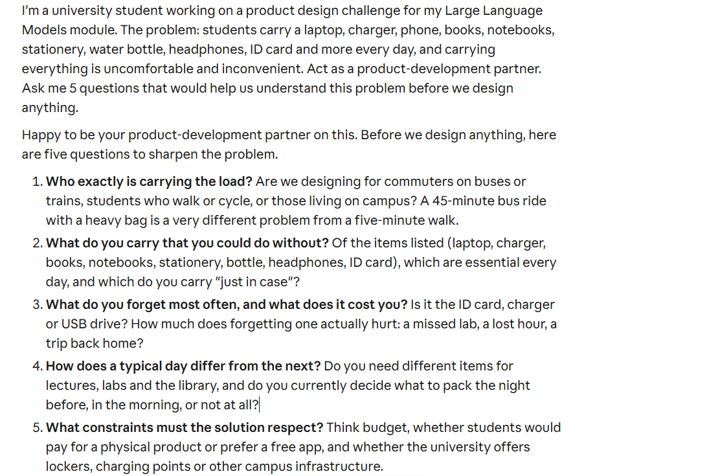
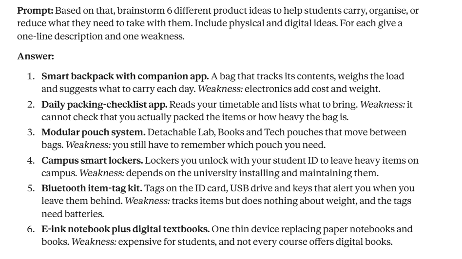
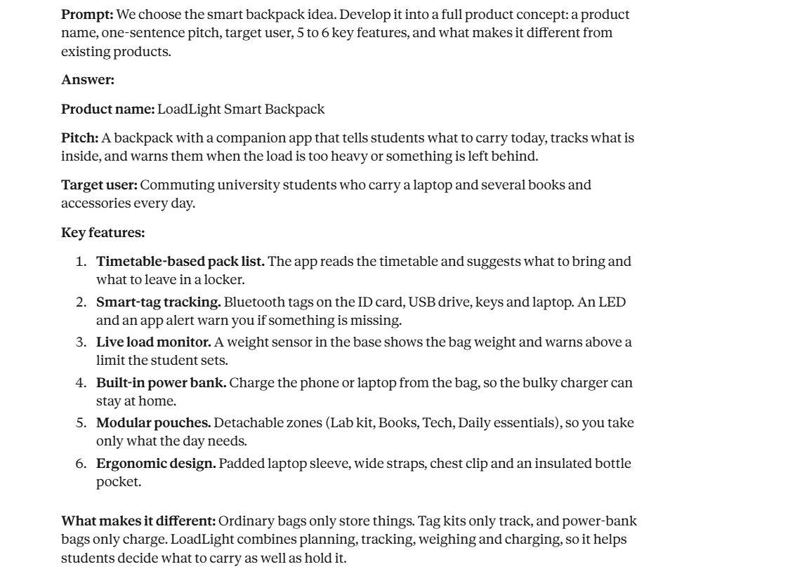
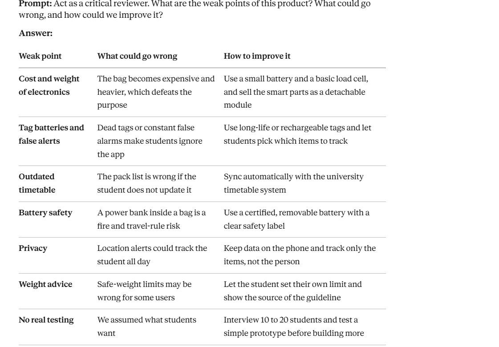
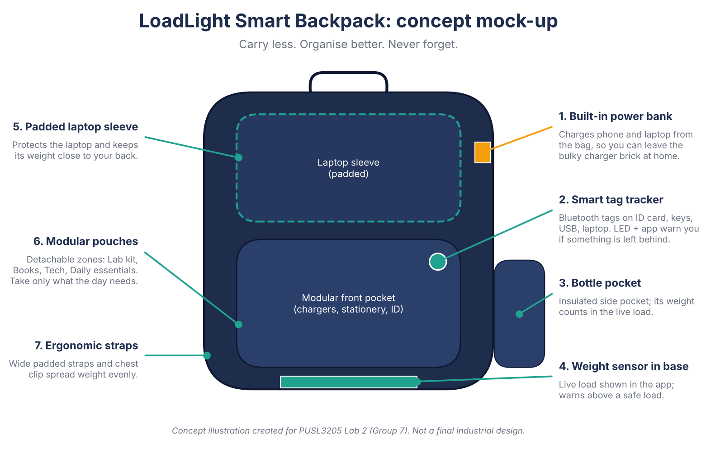
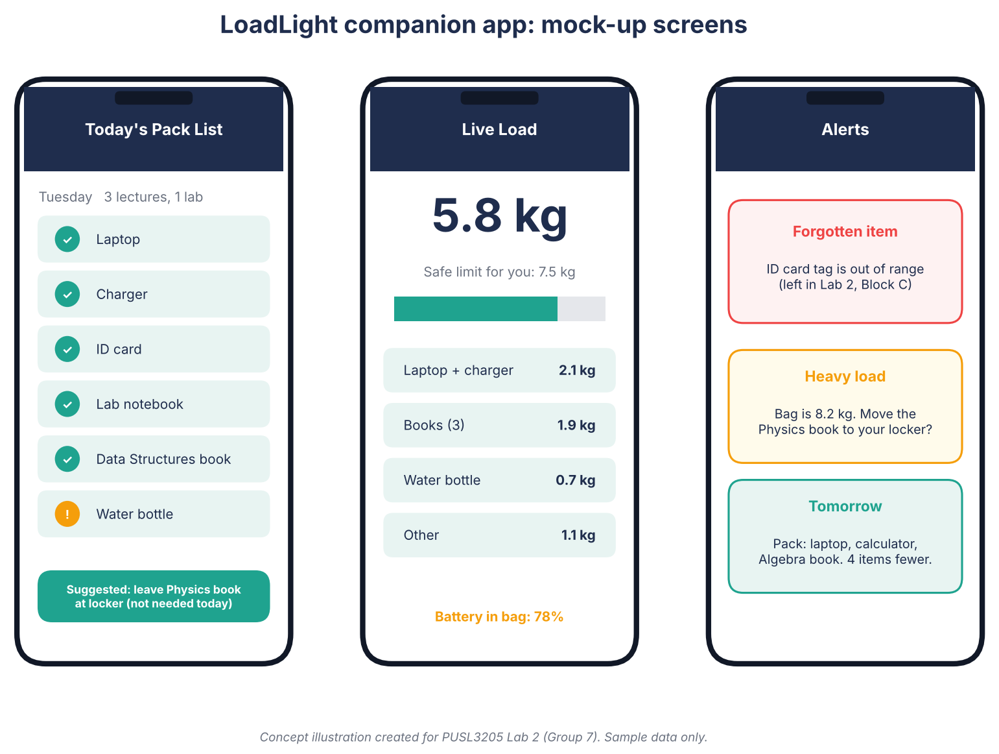
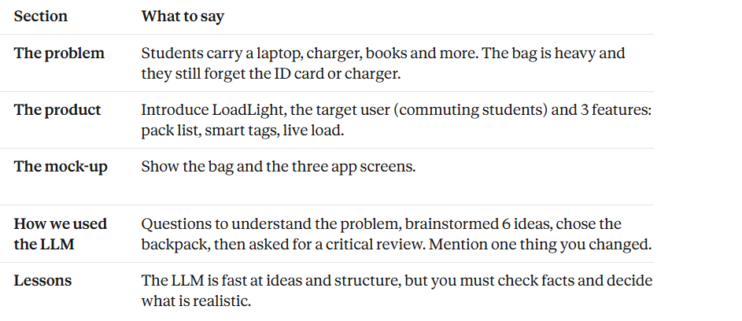

# Lab 02: LLMs in Everyday Life (Group 7: The Overloaded Student)

**Module:** PUSL3205 Large Language Models and Generative AI

## Laboratory Session
**Lab 2:** AI in Everyday Challenges. Group activity, **Group 7: The Overloaded Student**.

## Objective
The purpose of this activity was to apply an LLM to an everyday student problem, using it as a product-development partner. The goals were to practise critical thinking, problem solving and creativity, and to see how an LLM can be applied in a real-world situation.

**Challenge (Group 7):** A university day may require a laptop, charger, phone, books, notebooks, stationery, water bottle, headphones, ID card and more. Carrying everything is uncomfortable and inconvenient. The group had to design a product that helps students carry, organise, or reduce the number of things they take with them.

**Required outputs:** product concept, name, key features, target user and a visual prototype / mock-up.

## Group Documentation
| File | Content |
|---|---|
| [group-members.md](group-activity/group-members.md) | Group members and contributions |
| [activity-outcomes.md](group-activity/activity-outcomes.md) | Final product concept, features, target user, mock-ups |
| [discussion-summary.md](group-activity/discussion-summary.md) | How the LLM was used, ideas considered, changes, lessons |

## Tasks and Implementation
We used an LLM (Claude) as a product-development partner and worked through six stages.

1. **Understand the problem.** We asked the LLM to help clarify the problem and the user.
   
2. **Brainstorm ideas.** We asked for physical and digital ideas, each with a weakness.
   
3. **Choose and develop one idea.** The group chose the smart backpack and developed a full concept (name, pitch, target user, features, differences from existing products).
   
4. **Critical review.** We asked the LLM to find weaknesses and risks.
   
5. **Mock-up.** We produced concept illustrations of the bag and the app.
   
   
6. **Presentation.** We prepared a 2 to 3 minute presentation (outline below).
   

## Prompts Used
The prompts we sent to the LLM, in order. The matching screenshots are in `screenshots/`.

| # | Purpose | Prompt | Screenshot |
|---|---|---|---|
| 1 | Understand the problem | "I'm a university student working on a product design challenge. The problem: students carry a laptop, charger, phone, books, notebooks, stationery, water bottle, headphones, ID card and more every day, and carrying everything is uncomfortable and inconvenient. Act as a product-development partner. Ask me 5 questions that would help us understand this problem before we design anything." | `1_problem_questions.png` |
| 2 | Brainstorm ideas | "Based on that, brainstorm 6 different product ideas to help students carry, organise, or reduce what they need to take with them. Include physical and digital ideas. For each give a one-line description and one weakness." | `2_brainstorm.png` |
| 3 | Develop the chosen idea | "We choose the smart backpack idea. Develop it into a full product concept: a product name, one-sentence pitch, target user, 5 to 6 key features, and what makes it different from existing products." | `3_concept_development.png` |
| 4 | Critical review | "Act as a critical reviewer. What are the weak points of this product? What could go wrong, and how could we improve it?" | `4_critical_review.png` |
| 5 | Mock-up | "Create a simple visual mock-up of this smart backpack and its companion app. Describe the design and generate it as a diagram, wireframe or illustration." | `5_mockup_prompt.png` | `6_mockup_app.png` |
| 6 | Presentation | "Help us structure a 2 to 3 minute presentation covering: the problem, our product, our development process, and how we used LLMs." | `7_presentation_outline.png` |

## Results and Evidence

### Final product: LoadLight Smart Backpack
**Pitch:** A backpack with a companion app that tells students what to carry today, tracks what is inside, and warns them when the load is too heavy or something is left behind.

**Target user:** Commuting university students who carry a laptop and several books and accessories each day.

**Key features**
1. Timetable-based pack list, with suggestions to leave items in a locker or at home
2. Bluetooth smart-tag tracking for ID card, USB drive, keys and laptop
3. Live load monitor with a weight sensor in the base and a safe-limit warning
4. Built-in power bank, so a separate charger brick is not needed
5. Modular detachable pouches (Lab kit, Books, Tech, Daily essentials)
6. Ergonomic design: padded laptop sleeve, wide straps, chest clip, insulated bottle pocket

### Visual prototype

*Concept illustrations with sample data. They are not a final industrial design.*

### Presentation outline (2 to 3 minutes)
| Time | Content |
|---|---|
| 0:00 to 0:30 | The problem: the overloaded student |
| 0:30 to 1:15 | The product: LoadLight, target user, top 3 features |
| 1:15 to 1:45 | The mock-ups of the bag and the app |
| 1:45 to 2:30 | Development process: how we used the LLM and what we changed |
| 2:30 to 3:00 | What we learned and the limits of LLMs |

## Observations
- The LLM was very good at **generating and structuring ideas** quickly, for example turning a rough idea into a named concept with features and a target user.
- Its first answers tended to be **generic**, so the group had to narrow the target user and decide which features were realistic and affordable.
- Asking the LLM to **criticise its own concept** exposed real weaknesses (extra weight and cost, tag batteries, battery safety, privacy) that were not in the first answer.
- The LLM does not know real prices, campus rules or student habits. Claims such as safe bag-weight limits need to be checked against reliable sources.
- The mock-ups are concept illustrations. They communicate the idea but would need a professional designer and real user testing.
- *(Add your own observations here: what surprised the group, what you disagreed with, and where you changed the LLM's suggestions.)*

## Learning Outcomes
- Used an LLM as a design partner, using step-by-step prompts for problem analysis, brainstorming, concept development, critique and presentation planning.
- Learned that prompt quality and follow-up questions strongly affect the usefulness of the answers.
- Practised critical thinking by checking and challenging LLM output instead of accepting it.
- Understood both the strengths (speed, structure, variety) and limits (generic answers, unverified facts, no real-world knowledge of the campus) of LLMs in product design.
- Practised teamwork and communicating a product idea in a short presentation.
