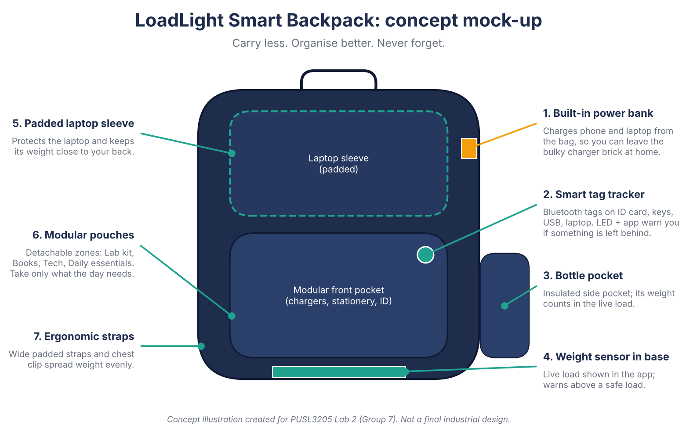
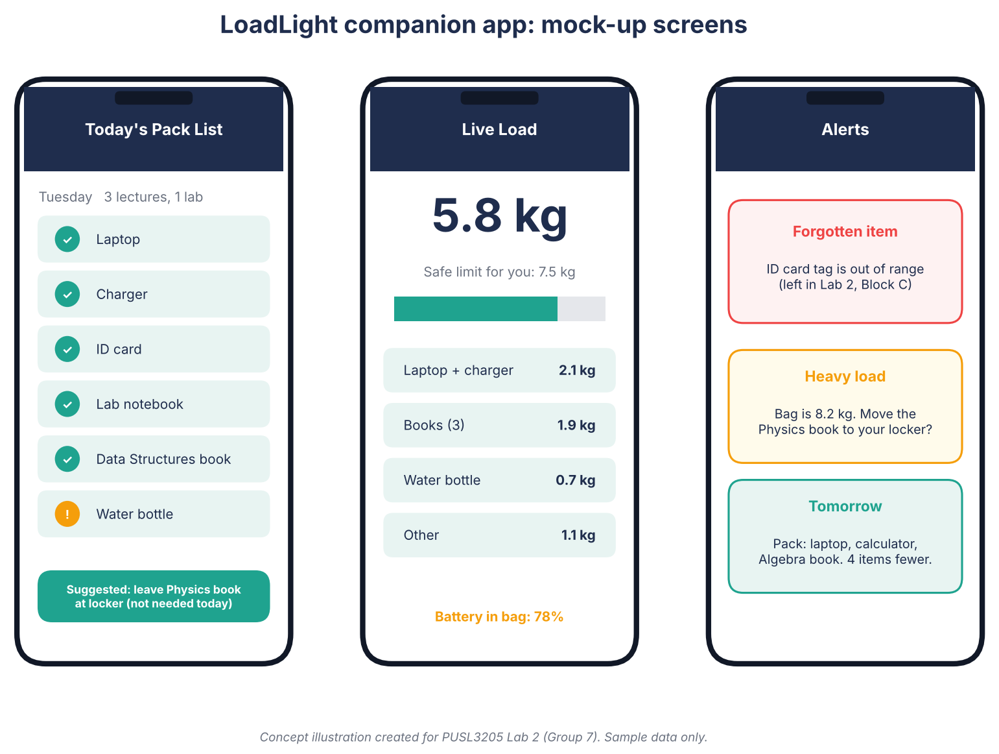

# Activity Outcomes: Group 7, The Overloaded Student

## Product name
**LoadLight Smart Backpack**

## One-sentence pitch
A backpack with a companion app that tells students what to carry today, tracks what is inside, and warns them when the load is too heavy or something is left behind.

## Target user
University students who commute and carry a laptop and several books and accessories each day, especially first- and second-year students whose timetable changes between lecture, lab and study days.

## Problem it solves
Students carry too much "just in case", forget items such as ID cards and chargers, and have no idea how heavy their bag has become. Ordinary bags only store things. They do not help students decide what to carry.

## Key features
1. **Timetable-based pack list.** The app reads the student's timetable and lists what is needed today, and suggests items to leave at home or in a locker. This reduces the number of things carried.
2. **Smart tag tracking.** Small Bluetooth tags on the ID card, USB drive, keys and laptop. An LED on the bag and an app alert warn the student if a tagged item is missing when they leave a room.
3. **Live load monitor.** A weight sensor in the base shows the bag weight in the app and warns when it passes a limit the student sets (commonly about 10% of body weight is suggested for school bags).
4. **Built-in power bank.** A slim battery with a USB-C port in the bag lets the student charge a phone or laptop without carrying a separate charger brick.
5. **Modular pouches.** Detachable zones (Lab kit, Books, Tech, Daily essentials) so the student takes only the zones needed for the day.
6. **Ergonomic design.** Padded laptop sleeve next to the back, wide padded straps, a chest clip and an insulated bottle pocket to spread the weight.

## What makes it different
| Existing option | Limitation | LoadLight |
|---|---|---|
| Ordinary backpack | Only stores items | Helps decide what to carry |
| Item-tracker tags (sold separately) | Tracks items, ignores weight and planning | Tracks, weighs and plans in one system |
| Power-bank backpacks | Add a battery but no organisation | Battery plus organisation plus load control |
| Locker | Fixed place, not linked to timetable | Suggests what to leave in a locker each day |

## Visual prototype
**Concept mock-up of the bag:**

**Companion app screens (Pack list, Live load, Alerts):**

The bag illustration labels the seven main parts. The app mock-up shows today's pack list with a suggestion to leave a book in a locker, the live load against a safe limit, and alerts for a forgotten item and a heavy load. These are concept illustrations with sample data. They are not a final industrial design.

## Risks and limitations
- Sensors, battery and electronics add cost and weight to the bag itself.
- Bluetooth tags need batteries and can give false alerts.
- Students must keep their timetable up to date in the app.
- A power bank in a bag must follow battery safety and travel rules.
- This is a concept only: no prototype has been built or tested with real users.

## Possible next steps
- Interview 10 to 20 students about what they carry and forget.
- Build a low-cost prototype with a load cell and Bluetooth tag.
- Test whether the pack-list suggestions really reduce the weight carried.
