# Lab 03: Developing a Tiny Transformer Language Model

**Module:** PUSL3205 Large Language Models and Generative AI


## Laboratory Session
**Lab 3:** Developing a Tiny Transformer Language Model

## Objective
The purpose of this lab was to build, train and evaluate a small decoder-only Transformer language model from scratch in PyTorch, using the TinyStories dataset, and to generate short stories with it. The lab also covers how architecture choices (layers, heads, epochs) change the loss and the generated text.

**Dataset:** roneneldan/TinyStories (Hugging Face). **Tokenizer:** character level. **Framework:** PyTorch.

## Folder Structure
```
Lab-03-Tiny-Transformer/
├── README.md
├── notebooks/
│   └── lab03_tiny_transformer.ipynb
└── results/
    └── 1_dataset_stories.png ... 12_gradio.png   (screenshots of outputs)
    
```

## Tasks and Implementation
Full code: [`notebooks/lab03_tiny_transformer.ipynb`](notebook/lab03_tiny_transformer.ipynb)

### Task 1: Load the dataset
Downloaded the first part of the `roneneldan/TinyStories` text files from Hugging Face (about 3 MB of `TinyStories-train.txt` and 0.5 MB of `TinyStories-valid.txt`) and split them into [3000] training stories and [300] validation stories. I used a direct download instead of the `datasets` library because a Windows security policy blocked the `pyarrow` library that `datasets` needs. Displayed several stories and examined their length in characters and words and their structure (short paragraphs, simple words).

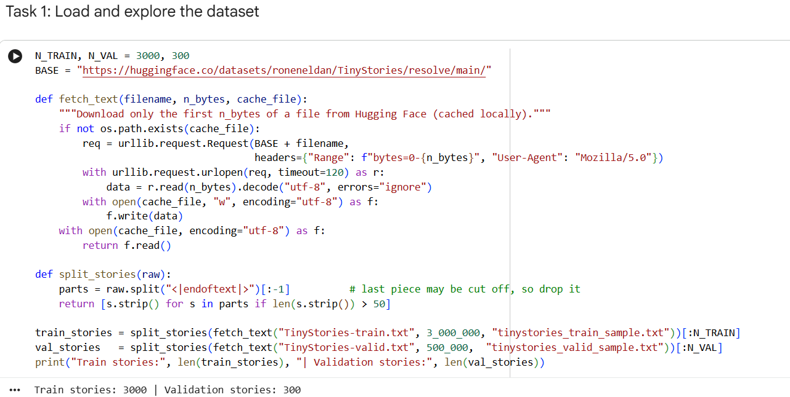
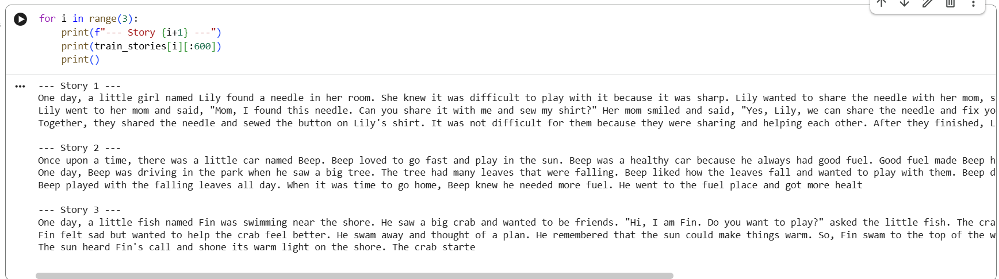
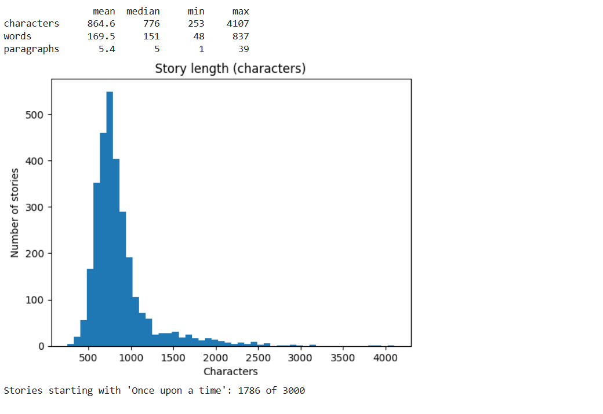

### Task 2: Preprocess and tokenize
Cleaned special symbols, joined the stories into one text and used a character-level tokenizer with a vocabulary of [74] characters.

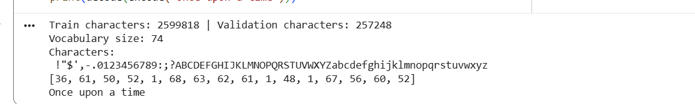

### Task 3: Prepare training data
Created input blocks of [128] characters and targets shifted by one character (next-token prediction), in batches of [32].

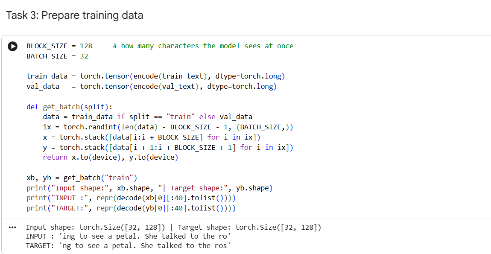

### Task 4 and 5: Build the Transformer and initialize it
Built token embeddings, positional embeddings, masked multi-head self-attention, feed-forward layers (GELU), residual connections and layer normalization, stacked in [4] blocks with [4] heads and embedding size [128]. Weights start from Normal(0, 0.02). The loss is cross-entropy and the optimizer is AdamW (learning rate [1e-3]). The model has [819,200] parameters. The initial loss was [value], close to ln(vocab size) = [ 4.304 ], as expected for an untrained model.

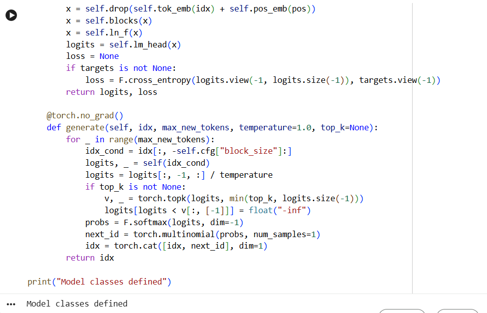
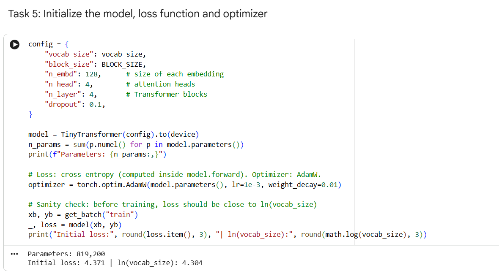

### Task 6: Train the model
Trained for [8] epochs of [100] steps. Each step predicts the next characters, computes the cross-entropy loss, backpropagates, clips gradients and updates the parameters.

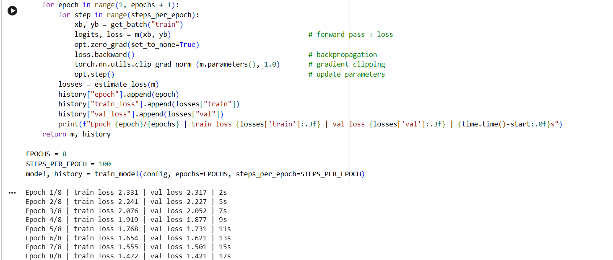

### Task 7: Monitor training
Recorded training and validation loss every epoch and plotted the loss curves.

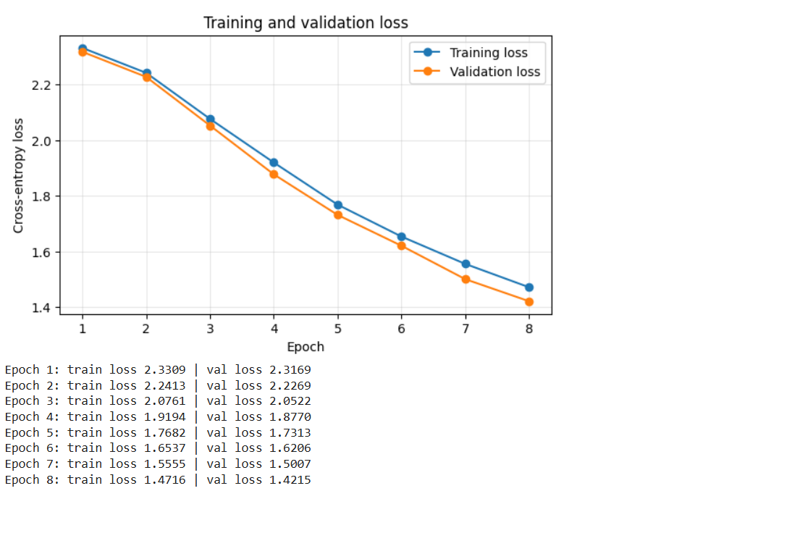

### Task 8: Evaluate the model
Calculated validation loss and perplexity (per character).

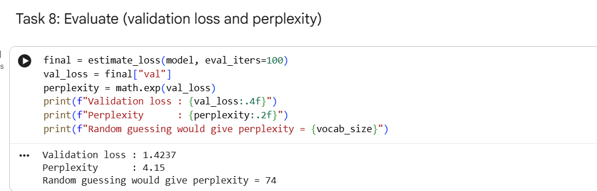

### Task 9: Generate stories
Generated text from "Once upon a time" and other prompts, using temperature and top-k sampling.

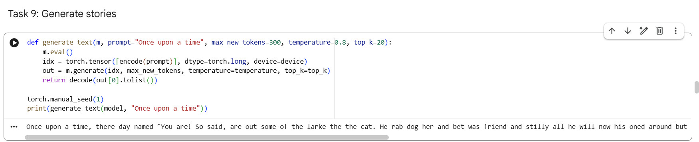
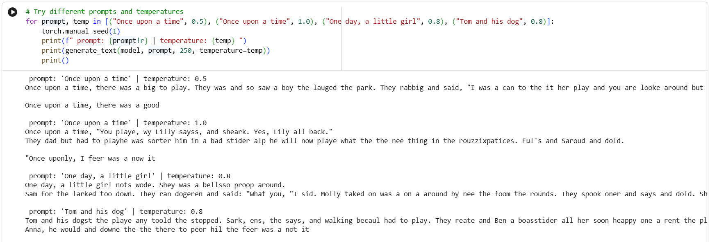

### Task 10: Experiment with model settings
Compared 1 vs 2 vs 4 layers, 1 vs 4 heads, and the effect of the number of epochs.

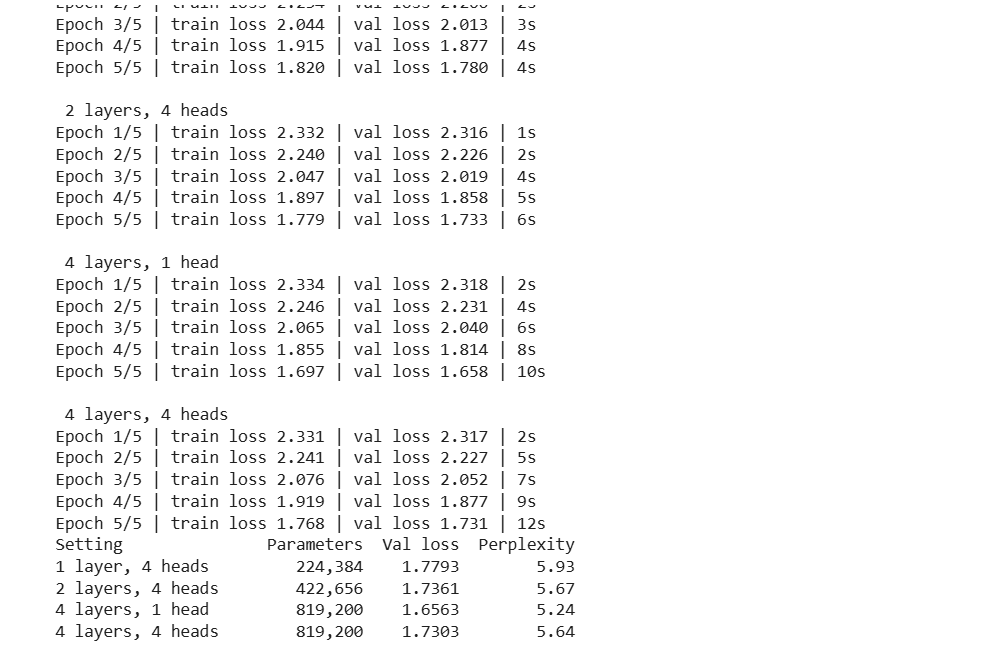
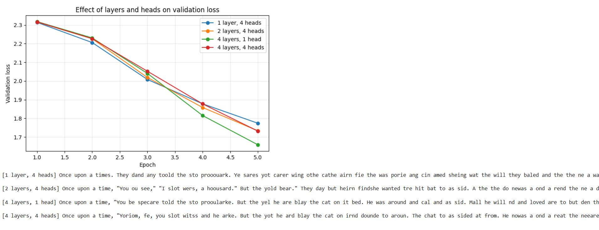
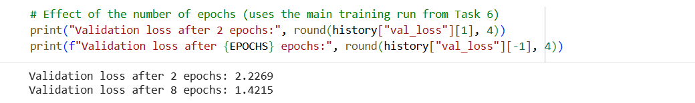

### Task 11: Save the model
Saved the parameters, the configuration and the vocabulary, then loaded them back and generated text to check.

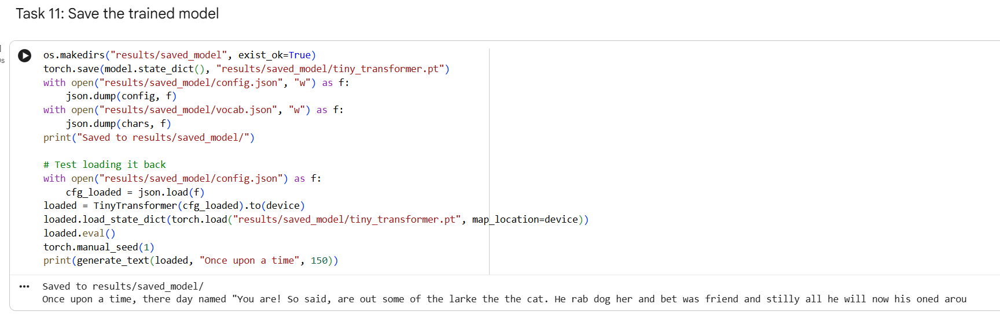

### Optional: Chat window (Gradio)
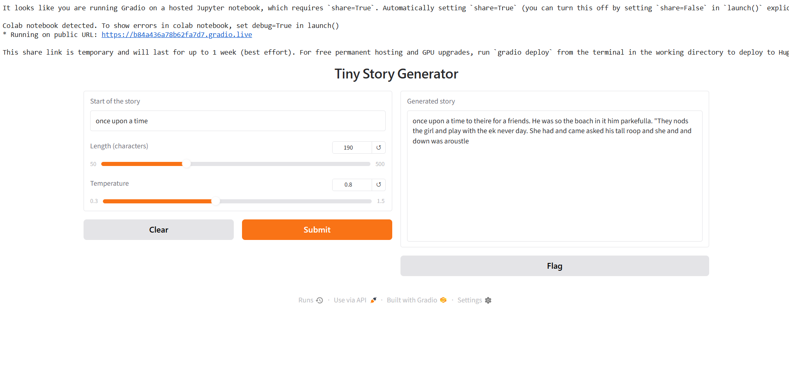

## Results and Evidence
The screenshots for each task are shown above. The key results are summarised here.

### Evaluation
| Metric | Value |
|---|---|
| Final training loss | [1.4716] |
| Final validation loss | [1.4237] |
| Perplexity (per character) | [4.15] |
| Random-guess perplexity | [74] |

### Example generated story ("Once upon a time")
```
Once upon a time, there was a but around fround! She was a speatch was and say. He looked the dowd had to her couldly hid finds! He pooke and make the evil at he put namil and said, "Wen't wide in your duck stay, I wet it was goods. It says wated he was dide the now.
```

### Model-setting experiments
| Setting | Parameters | Val loss | Perplexity |
|---|---|---|---|
| 1 layer, 4 heads | [ 224,384 ] | [ 1.7793  ] | [ 5.93 ] |
| 2 layers, 4 heads | [ 422,656  ] | [ 1.7361  ] | [ 5.67 ] |
| 4 layers, 1 head | [ 819,200  ] | [ 1.6563  ] | [ 5.24 ] |
| 4 layers, 4 heads | [ 819,200 ] | [ 1.7303  ] | [ 5.64 ] |

Effect of epochs (main run): validation loss [2.2269] after 2 epochs and [1.4215] after [8] epochs.

## Observations
- **Dataset:** [typical story length, simple vocabulary, common openings]
- **Training:** [did the loss fall steadily? was validation loss close to training loss?]
- **Generated text:** [were words real? grammar? did the story stay on topic?]
- **Temperature:** [what changed with low and high temperature?]
- **Experiments:** [which setting had the lowest loss; did more layers or heads help; how did text change]
- **Limits:** the model is tiny and trained on a small subset for a short time, so stories are short-range and often inconsistent. Character-level modelling also makes the model learn spelling before meaning.
- **Challenges:** On my computer `import pandas` and then `import torch` failed with "An Application Control policy has blocked this file" (Windows security blocked the `pyarrow` and `torch` DLL files), so the notebook could not run locally. I avoided the `datasets` library by downloading the dataset text files directly from Hugging Face, and ran the notebook in Google Colab with a GPU. [add other challenges]

## Discussion: Mechanisms that improve performance
- **Token and positional embeddings:** turn characters into vectors and tell the model where each character is, since attention alone ignores order.
- **Masked (causal) self-attention:** each position can use earlier characters as context but cannot see future ones, which is what makes next-token prediction a fair task.
- **Multi-head attention:** several heads look at different relationships at the same time.
- **Feed-forward layers:** add non-linear processing after attention.
- **Residual connections:** let information and gradients flow through deep stacks so the model trains more easily.
- **Layer normalization:** keeps values stable, making training faster and steadier.
- **Dropout and weight decay:** reduce overfitting.
- **AdamW and gradient clipping:** efficient and stable updates.
- **Weight tying:** shares embedding and output weights, reducing parameters.
- **Sampling (temperature, top-k):** improves generated text without changing the model.
- **Data and training:** more data, more parameters and more training steps lower the loss further.

## Learning Outcomes
- Loaded and explored a language-model dataset with the Hugging Face `datasets` library.
- Built a character-level tokenizer and prepared next-token prediction data.
- Implemented the parts of a Transformer (embeddings, masked multi-head attention, feed-forward, residual connections, layer normalization) in PyTorch.
- Trained a language model, monitored loss, and calculated perplexity.
- Generated text and understood how sampling settings affect it.
- Compared model sizes and understood trade-offs between size, training time and quality.
- Saved and reloaded a trained model.

## How to Run
The notebook was run in **Google Colab** with a free T4 GPU, because a Windows security policy on my computer blocked the `torch` and `pyarrow` libraries.
1. Open colab.research.google.com, then **File → Upload notebook** and choose `notebooks/lab03_tiny_transformer.ipynb`.
2. Choose **Runtime → Change runtime type → T4 GPU**.
3. Run all cells (**Runtime → Run all**). Internet is used to download the dataset samples from Hugging Face. For the optional chat window, run `!pip install gradio` first.
4. To run locally instead: `pip install torch matplotlib numpy`, then open the notebook in Jupyter. On a CPU the full notebook can take roughly 30 to 90 minutes.

## Dataset Citation
Eldan, R. and Li, Y. (2023). *TinyStories: How Small Can Language Models Be and Still Speak Coherent English?* arXiv:2305.07759. Dataset: https://huggingface.co/datasets/roneneldan/TinyStories
