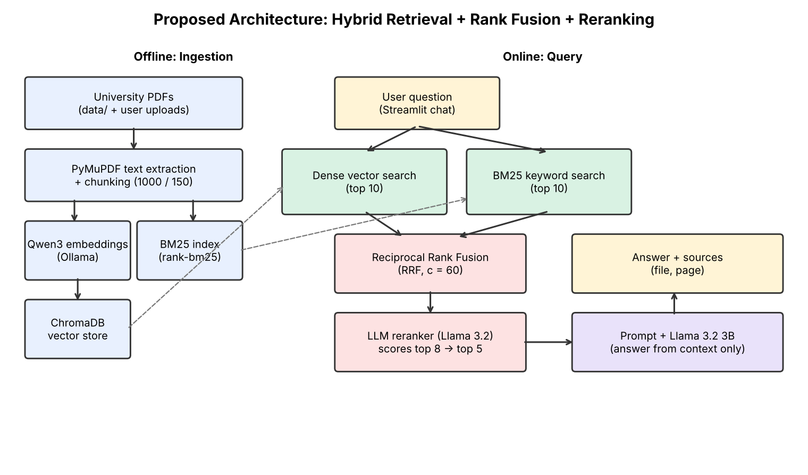
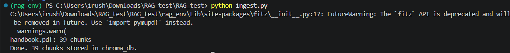
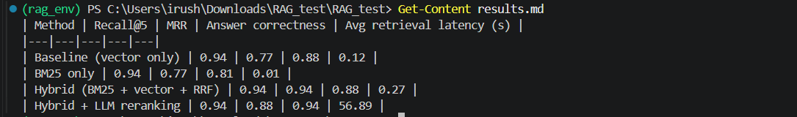
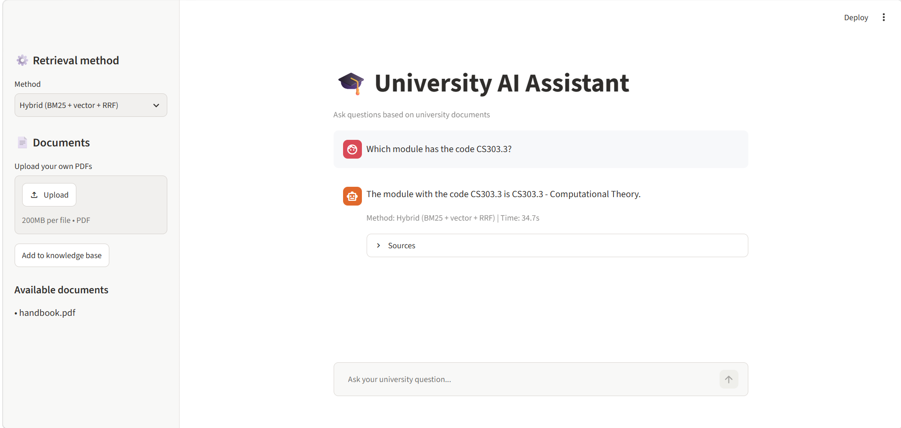
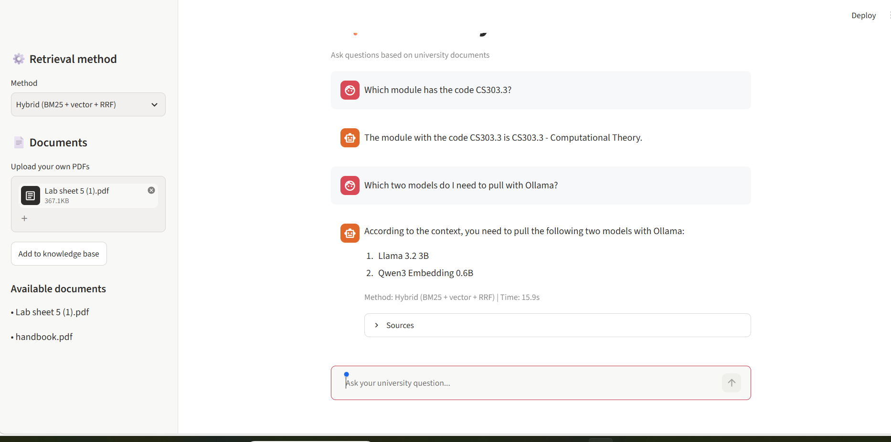

# University AI Assistant - Hybrid Retrieval RAG

PUSL 3205 - Large Language Models and Generative AI
**Group 1: Hybrid Retrieval and Reranking**

A RAG (Retrieval-Augmented Generation) app that answers questions from university PDF documents.
It improves a basic vector-search RAG by adding BM25 keyword search, Reciprocal Rank Fusion (RRF)
and LLM reranking.

## Features

- Reads all PDFs in the `data/` folder
- Users can upload their own PDFs in the app and ask questions about them
- 4 retrieval methods you can switch between in the sidebar:
  1. Baseline (vector search only)
  2. BM25 only
  3. Hybrid (BM25 + vector + RRF)
  4. Hybrid + LLM reranking
- Every answer shows its sources (file name and page number)
- Evaluation script that compares all 4 methods

## Tech Stack

Python, LangChain, ChromaDB, Ollama (Llama 3.2 3B + Qwen3 Embedding 0.6B), Streamlit, PyMuPDF, rank-bm25

## Architecture



## Project Structure

```
RAG_test/
├── app.py                  # Streamlit chat app (PDF upload + method selector)
├── rag_pipeline.py         # PDF loading, chunking, embeddings, ChromaDB
├── hybrid_rag.py           # BM25, vector search, RRF fusion, LLM reranking
├── ingest.py               # Loads all PDFs from data/ into ChromaDB
├── evaluate.py             # Compares the 4 retrieval methods
├── eval_dataset.json       # 16 questions + reference answers + supporting pages
├── requirements.txt
├── architecture_diagram.png
├── data/                   # Put PDFs here
└── screenshots/
```

## Setup (Windows)

1. Install [Python 3](https://www.python.org/downloads/) and [Ollama](https://ollama.com/download).

2. Download the models:
   ```
   ollama pull llama3.2:3b
   ollama pull qwen3-embedding:0.6b
   ```

3. Open the project folder in a terminal and create a virtual environment:
   ```
   python -m venv rag_env
   .\rag_env\Scripts\Activate.ps1
   python -m pip install --upgrade pip
   python -m pip install -r requirements.txt
   ```

## Run

1. Put your PDFs in the `data/` folder, then build the database:
   ```
   python ingest.py
   ```

2. Start the app:
   ```
   python -m streamlit run app.py
   ```

3. Choose a retrieval method in the sidebar, ask a question, or upload your own PDF and click
   **Add to knowledge base**.

## Evaluation

```
python evaluate.py --answers
```

Results on 16 questions about the NSBM Computing Awards Handbook:

| Method | Recall@5 | MRR | Answer correctness | Avg retrieval latency (s) |
|---|---|---|---|---|
| Baseline (vector only) | 0.94 | 0.77 | 0.88 | 0.12 |
| BM25 only | 0.94 | 0.77 | 0.81 | 0.01 |
| Hybrid (BM25 + vector + RRF) | 0.94 | 0.94 | 0.88 | 0.27 |
| Hybrid + LLM reranking | 0.94 | 0.88 | 0.94 | 56.89 |

**Findings**
- Hybrid retrieval raised MRR from 0.77 to 0.94 with almost no extra latency.
- LLM reranking gave the best answer correctness but was far too slow (about 57 s per question).
- Hybrid (BM25 + vector + RRF) is the best overall trade-off.
- Limitations: small dataset (16 questions), one document, keyword-based correctness metric.

## Screenshots

**1. Ingesting the PDFs**



**2. Evaluation results**



**3. App answering a question (Hybrid method)**



**4. Uploading and asking about your own PDF**



## Note: 
rag_env, chroma_db and __pycache__ are not included. Recreate them with the Setup and Run steps above.
