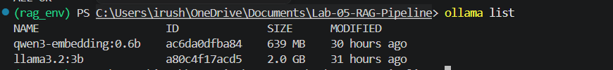
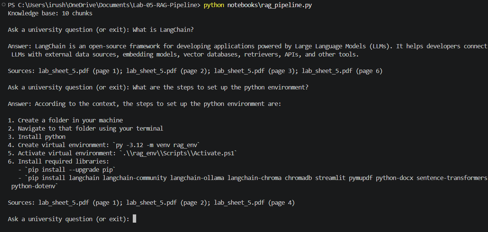
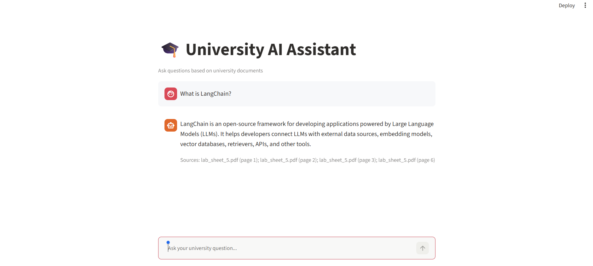
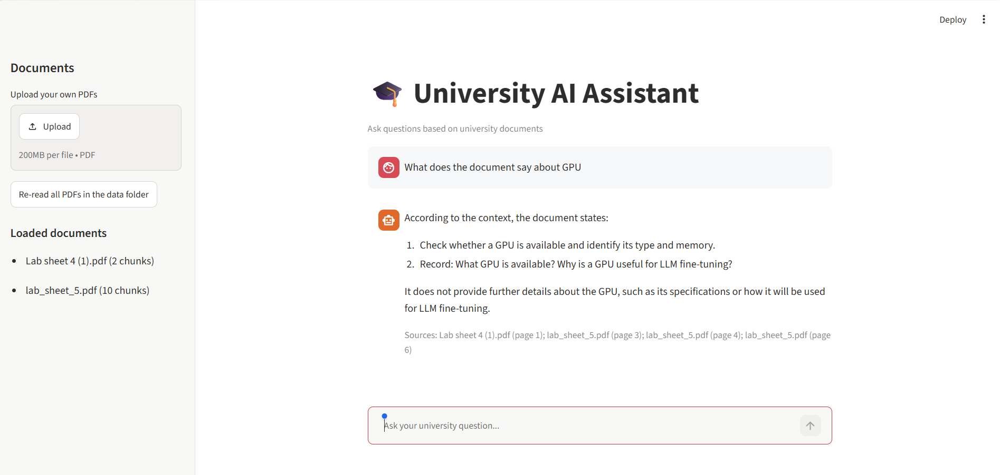

# Lab 5: RAG Pipeline for a University Knowledge Assistant

**Module:** PUSL3205 Large Language Models and Generative AI

## 1. Overview

This lab builds a Retrieval-Augmented Generation (RAG) application. Instead of relying only on what the LLM already knows, the app finds the most relevant parts of PDF documents and gives them to the LLM, so the answers are based on the documents. Everything runs locally with no paid API.

| Component | Tool |
|---|---|
| LLM | `llama3.2:3b` through Ollama |
| Embedding model | `qwen3-embedding:0.6b` through Ollama |
| Vector database | ChromaDB (saved on disk, cosine similarity) |
| PDF reader | `pypdf` |
| Chat window | Streamlit |
| Environment | Python virtual environment `rag_env` |

## 2. Folder structure

```
Lab-05-RAG-Pipeline/
├── README.md
├── requirements.txt
├── notebooks/
│   ├── ingest.py
│   ├── rag_pipeline.py
│   └── app.py
└── screenshots/
```

| File | Description |
|---|---|
| `ingest.py` | Reads PDFs, splits them into chunks, creates embeddings and stores them in ChromaDB |
| `rag_pipeline.py` | Finds the best chunks for a question and asks the LLM to answer from them |
| `app.py` | Streamlit chat window with PDF upload |
| `requirements.txt` | Python libraries used (saved with `python -m pip freeze`) |

The PDFs, the ChromaDB database (`chroma_db`) and the virtual environment (`rag_env`) are not included in this repository.

## 3. Setup

1. Created a project folder and opened it in the terminal.
2. Created and activated a virtual environment:
   ```
   python -m venv rag_env
   .\rag_env\Scripts\Activate.ps1
   ```
3. Installed the libraries:
   ```
   python -m pip install --upgrade pip
   python -m pip install chromadb streamlit pypdf
   ```
4. Checked ChromaDB:
   ```
   python -c "import chromadb; print('ChromaDB installed successfully')"
   ```
5. Downloaded the models and checked them with `ollama list`:
   ```
   ollama pull llama3.2:3b
   ollama pull qwen3-embedding:0.6b
   ```
6. Saved the dependencies:
   ```
   python -m pip freeze > requirements.txt
   ```



## 4. How the RAG pipeline works

1. **Load:** `pypdf` extracts the text of each page of every PDF in the `data` folder.
2. **Split:** the text is cut into chunks of 800 characters, with 100 characters of overlap so that sentences are not lost at the edges.
3. **Embed:** each chunk is turned into a vector by `qwen3-embedding:0.6b`.
4. **Store:** the vectors, the chunk text and the metadata (PDF name and page number) are saved in ChromaDB.
5. **Retrieve:** the question is embedded the same way, and the 4 most similar chunks are found.
6. **Generate:** the chunks are given to `llama3.2:3b` with the instruction to answer only from them. If the answer is not in the chunks, the model says so.
7. **Cite:** the app shows which PDFs and pages were used.

## 5. Results

### RAG pipeline in the terminal

`rag_pipeline.py` answers questions from the command line.



### Streamlit chat window

`app.py` shows the same pipeline in a chat window called "University AI Assistant".



## 6. Task: read more PDFs and let users upload their own

The app was extended in two ways:

- **More PDFs:** `ingest.py` reads every PDF in the `data` folder. The side panel has a button that re-reads them all, and a list shows each loaded document with its number of chunks.
- **User uploads:** the side panel has an upload box. An uploaded PDF is saved in the `data` folder, converted into chunks and added to ChromaDB straight away, so questions can use it immediately.

Every answer shows its sources, so it is clear which PDF the answer came from.



## 7. Differences from the lab sheet and limitations

- **No LangChain.** A Windows security policy on my computer blocked one of the LangChain files, so the code calls the Ollama REST API directly (`http://localhost:11434`) and uses the ChromaDB library for storage. The pipeline is the same: load, split, embed, store, retrieve, generate. For the same reason I did not install `langchain-community`, `langchain-ollama`, `langchain-chroma`, `sentence-transformers` and `python-dotenv`, and I used `pypdf` instead of `pymupdf`.
- **Test documents.** I did not have the university handbook, so I tested the app with the Lab Sheet 5 PDF and a second PDF. The app works the same way with any PDF.
- **Small model.** A 3B model can make mistakes, and the answer is only as good as the chunks that were retrieved.
- **Fixed-size chunks.** Chunks are cut at a fixed size, so a table or a list can be split across two chunks.

## 8. How to run

1. Install Ollama and download the two models (see section 3).
2. Create and activate a virtual environment, then install the libraries:
   ```
   python -m venv rag_env
   .\rag_env\Scripts\Activate.ps1
   python -m pip install -r requirements.txt
   ```
3. Create a folder called `data` inside `notebooks` and put your PDFs in it.
4. Read the PDFs into the database:
   ```
   python notebooks\ingest.py
   ```
5. Ask questions in the terminal:
   ```
   python notebooks\rag_pipeline.py
   ```
6. Or start the chat window:
   ```
   python -m streamlit run notebooks\app.py
   ```
